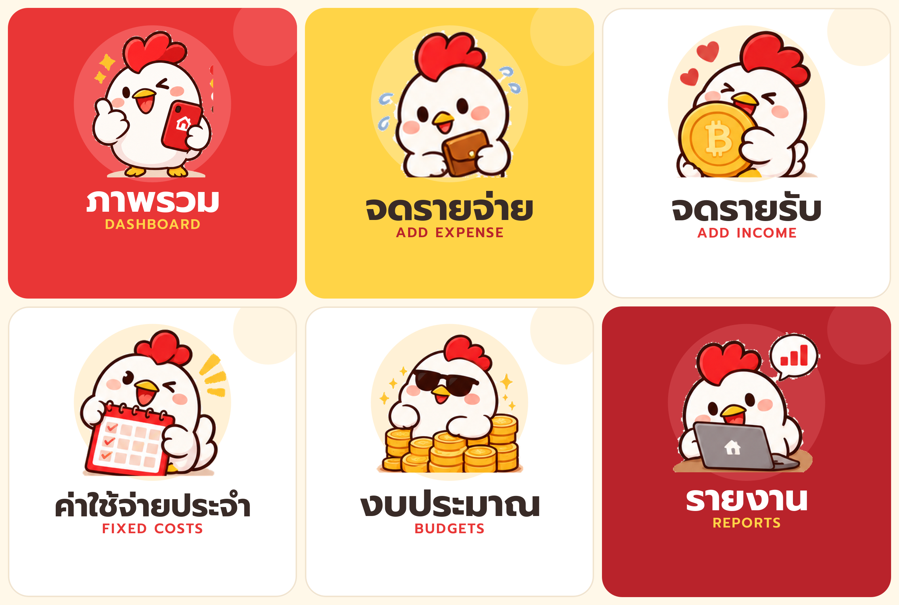

# ShikSheek 🐔 — ให้เรื่องเงินเป็นเรื่องชิกชิก!

ผู้ช่วยการเงินส่วนตัวบน LINE พร้อมมาสคอตไก่ชิกชิก จดรายรับรายจ่ายด้วยภาษาพูด ("กินข้าว 65")
ติดตามค่าใช้จ่ายประจำ งบประมาณ เป้าหมายออม และรับสรุปรายวัน/รายเดือนใน LINE

<p align="center"></p>

## ทำอะไรได้บ้าง

| | |
|---|---|
| ✍️ **จดด้วยภาษาพูด** | "กินข้าว 65", "ซื้อกาแฟ 80 เมื่อวาน", "ได้เงินเดือน 25000" → การ์ดยืนยัน → กดยืนยัน → บันทึก |
| ❓ **ถามได้** | "วันนี้ใช้ไปเท่าไหร่", "เดือนนี้เหลือเงินเท่าไหร่", "พรุ่งนี้มีค่าอะไรต้องจ่ายบ้าง" |
| 💰 **ยอดใช้ได้จริง** | หักบิลที่ยังไม่จ่ายและเงินที่กันไว้ออมให้แล้ว พร้อมเฉลี่ยใช้ได้ต่อวัน |
| 📅 **ค่าใช้จ่ายประจำ** | รายสัปดาห์/เดือน/ปี/ทุก N วัน — เตือนก่อนกำหนด จ่าย/ข้าม/หยุด/ลบ ไม่หักซ้ำ |
| 🎯 **งบ & เป้าออม** | เตือนที่ 50/80/100% (ครั้งเดียวต่อรอบ), เป้าหมายออมพร้อมความคืบหน้า |
| 📊 **สรุปอัตโนมัติ** | รายวัน 21:00, เตือนบิล 08:00, รายสัปดาห์, สิ้นรอบเดือน (เวลาไทย) |
| 🔒 **ข้อมูลของคุณ** | ส่งออก CSV/JSON (ลิงก์ใช้ครั้งเดียว), ลบข้อมูลทั้งหมดได้ |

## สถานะ

ทำครบทั้ง 10 เฟสแล้ว และมี**เทสอัตโนมัติ 253 ตัวที่ผ่านทั้งหมด** (เงิน, การเกิดซ้ำ, webhook จริงที่เซ็นลายเซ็น, การแยกข้อมูลผู้ใช้, scheduler, Flex template ทุกตัว)
**สิ่งที่ยังไม่ได้ทำ:** ยังไม่ได้ deploy ขึ้น Supabase/LINE จริง (ต้องใช้บัญชีของเจ้าของ) และยังไม่ได้ยิง `validate-flex` กับ API ของ LINE → ทำตาม [docs/deployment.md](docs/deployment.md)

## Stack

| ชั้น | เทคโนโลยี |
|---|---|
| ภาษา | TypeScript (Node สำหรับเทส/สคริปต์, Deno บน Supabase Edge Functions) |
| ฐานข้อมูล | Supabase Postgres — เงินเก็บเป็น `BIGINT` หน่วยสตางค์, RLS ทุกตาราง |
| Webhook & งานตามเวลา | Supabase Edge Functions + pg_cron (Asia/Bangkok) |
| LINE | Messaging API (fetch), Flex Messages, Rich Menu 2500×1686 |
| ตรวจข้อมูล | Zod |
| AI (ไม่บังคับ) | Claude ผ่าน `@anthropic-ai/sdk` — แค่ช่วยตีความข้อความและเขียนคำพูด |
| เทส | Vitest + PGlite (Postgres จริงในโปรเซส ไม่ต้องใช้ Docker) |

## โครงสร้าง

```
src/
  domain/               ตรรกะธุรกิจล้วน ไม่มี I/O — money, dates, period, recurrence, calculations/
  application/          use cases: services/, parser/ (ภาษาไทย), personality/, jobs.ts, webhook.ts
  infrastructure/       db/ (SQL + repositories), line/ (client, signature, schema), ai/ (Claude)
  presentation/line/    router, handlers/, flex/ (templates), mascot.ts, rich-menu/
  config/env.ts         ตรวจ env ด้วย Zod
  app.ts                composition root
supabase/
  migrations/           schema, export tokens, cron (Supabase-only)
  functions/            line-webhook, scheduler, data-export
scripts/                build-mascots, build-rich-menu, setup-rich-menu, upload-assets, validate-flex
assets/                 mascot/, rich-menu/, branding/, fonts/
tests/                  unit/, integration/ (PGlite + webhook end-to-end)
docs/                   deployment, line-setup, troubleshooting, database, decisions, mascot
```

## เริ่มต้น (ในเครื่อง)

```bash
npm install
npm test
npm run typecheck
```

Deploy จริง: **[docs/deployment.md](docs/deployment.md)** · ตั้งค่า LINE: **[docs/line-setup.md](docs/line-setup.md)** · ปัญหา: **[docs/troubleshooting.md](docs/troubleshooting.md)**

## หลักความถูกต้องของเงิน

- เงินทุกจำนวนเป็น **จำนวนเต็มสตางค์** ไม่มี float (แปลงจากข้อความแบบ exact)
- **ไม่บันทึกอะไรจนกว่าจะกดยืนยัน** · กดซ้ำ/กดพร้อมกันได้ผลครั้งเดียว (atomic update)
- **บิลที่จ่ายแล้วนับครั้งเดียว**: จ่าย = flip สถานะ + สร้างรายจ่ายใน transaction เดียว และ DB บังคับ 1 บิลจ่ายได้ 1 รายการ
- บิลประจำสร้างซ้ำไม่ได้ (`UNIQUE(fixed_cost_id, occurrence_key)`) · วันที่ 31 → ใช้วันสุดท้ายของเดือน ไม่เลื่อน
- **AI ห้ามคำนวณ/แก้ยอดเงิน**: ข้อเสนอจาก AI ต้องผ่านการยืนยันเหมือนกัน และจำนวนเงินต้องปรากฏในข้อความของผู้ใช้เท่านั้น
- template แค่จัดรูปแบบ ตัวเลขทั้งหมดมาจาก `src/domain/calculations`

สูตร: `ใช้ได้อีก = รายรับ − รายจ่าย − ออมแล้ว − บิลค้างจ่าย − ยอดที่ต้องกันไว้ออม` (ไม่ยกยอดข้ามรอบ) · รายละเอียด [docs/decisions.md](docs/decisions.md)

## ความปลอดภัย

- ตรวจลายเซ็น LINE จาก raw body (HMAC-SHA256, constant-time) · กัน webhook ซ้ำด้วย `webhookEventId`
- ทุก query ผูกกับ `user_id` ของผู้ส่ง (มีเทสว่าผู้ใช้อื่นยืนยัน/ลบ/จ่ายของคนอื่นไม่ได้)
- RLS เปิดทุกตาราง ไม่มี policy ให้ `anon`/`authenticated` · secrets อยู่ใน Supabase secrets/Vault เท่านั้น
- log ไม่มีจำนวนเงิน และย่อ user id · ลิงก์ส่งออกข้อมูลใช้ได้ครั้งเดียว 15 นาที เก็บแค่ hash
- ข้อจำกัด: ยังไม่มี rate limit ต่อผู้ใช้ (เหมาะกับใช้ส่วนตัว/กลุ่มเล็ก)
